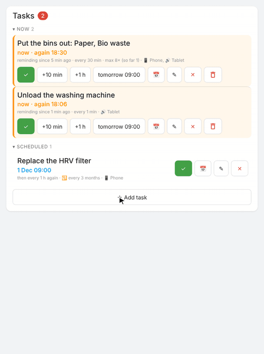
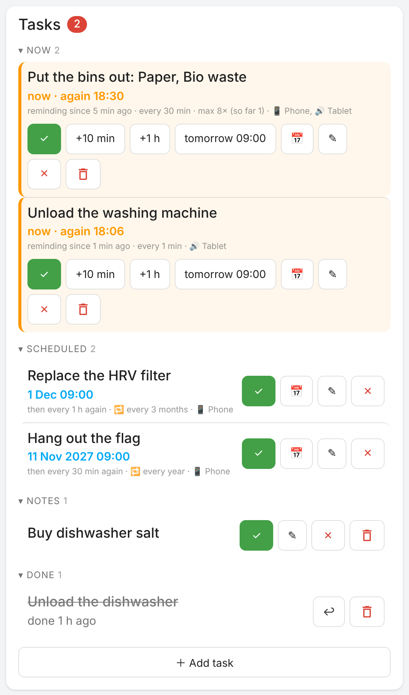
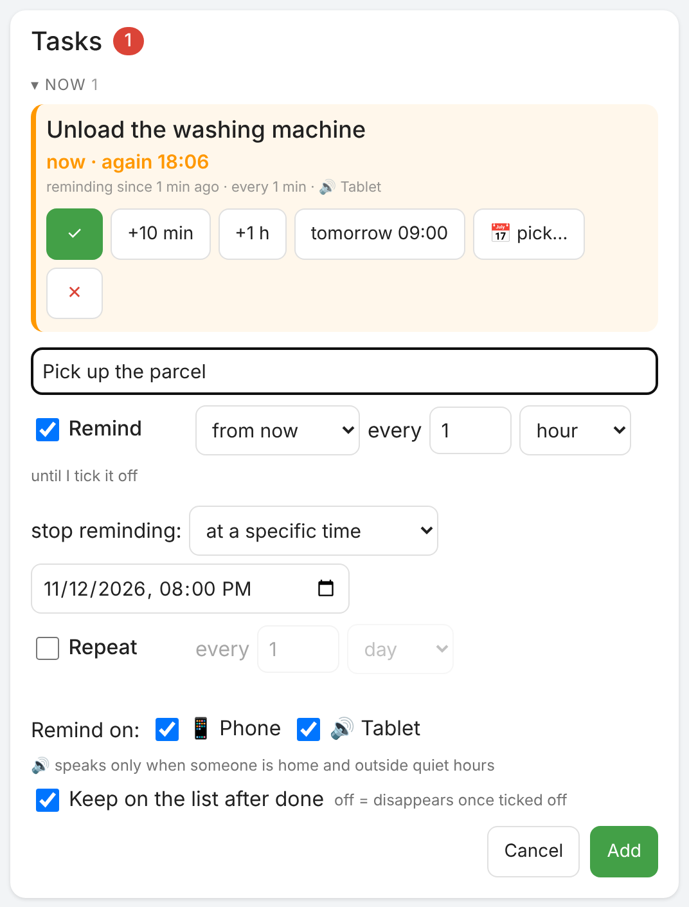
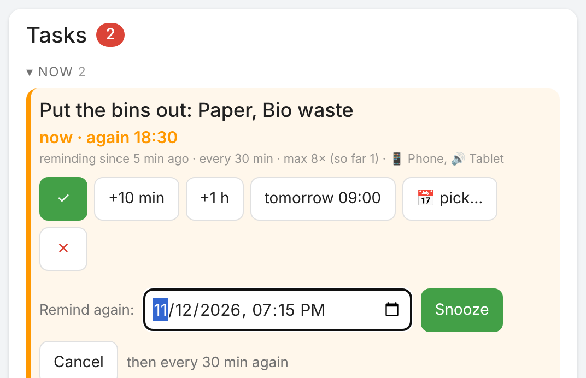
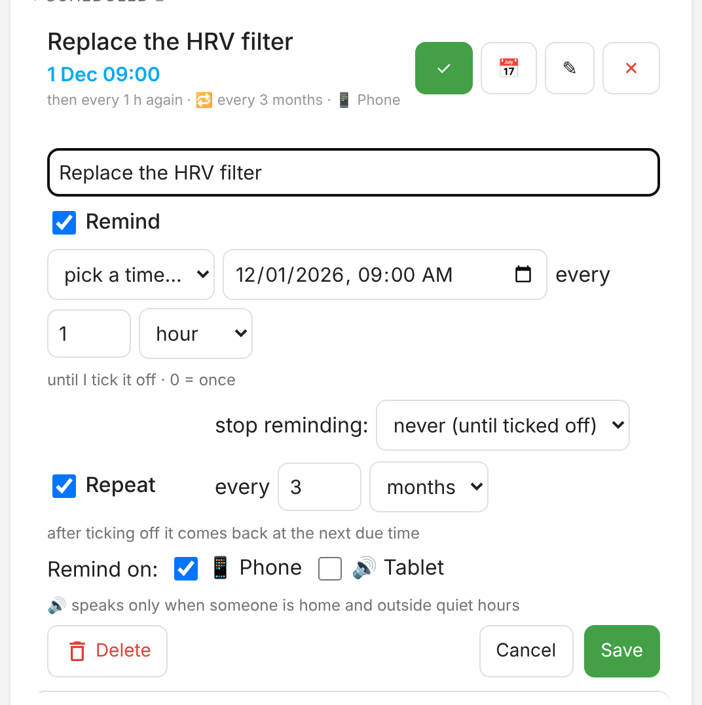

# Remindo — tasks that keep reminding you, for Home Assistant

🇬🇧 English · 🇵🇱 [Polski](README.pl.md)

A Home Assistant integration that turns "remember to…" into tasks that **keep reminding you** until you tick them off.

- 📋 **Task list** (`todo.remindo`), also visible in the standard To-do card and the calendar.
- ⏰ **Reminders every X minutes/hours** until you react, with a limit ("at most 3 times" or "until 22:00").
- 📱 **Push to phones** with ✅ Done / ⏰ Snooze / ❌ Skip buttons. After any action the notification disappears from every phone.
- 🔊 **Spoken announcement** (TTS) on a tablet or speaker, only when someone is home and outside quiet hours. Announcements queue up: Remindo waits until the speaker is quiet (e.g. another automation is talking) instead of cutting it off.
- 🔁 **Recurring tasks**: every N hours / days / weeks / months / years (e.g. "HRV filter every 3 months").
- 🤖 **Rules**: a task adds itself when a device reaches a state (dishwasher finished, garage open for 10 min, humidity > 70%) or the day before a calendar event (bin collection). It closes itself when the condition ends.
- 🗂️ **Lovelace card** shipped with the integration: Now / Scheduled / Notes / Done / Skipped, one-tap snooze, adding tasks by hand.
- 📣 **Any channel**: the HA mobile app (with buttons) plus Telegram, e-mail, SMS and any other notifier you have in HA (text only).
- ✅ **Message when resolved**: e.g. "Garage door closed ✅" when a task closes itself.
- 🌍 English and Polish.

<p align="center"></p>

⭐ **If Remindo is useful to you, please star the repository on GitHub.** It helps other Home Assistant users find it.

## Installation

Requires Home Assistant **2026.11** or newer.

### Marketplace (recommended)
1. *Settings → **Marketplace*** → **⋮** menu → **Add from link**.
2. Paste `https://github.com/szczukot/ha-remindo` → **Remindo** → **Install**.
3. If Home Assistant asks for a restart (*Settings → System → Repairs*), restart it.
4. *Settings → Devices & services → Add integration → **Remindo*** (the Marketplace may open this step for you right after installing).

### Manual
Copy `custom_components/remindo` to `/config/custom_components/` (e.g. with the File editor or Samba add-on), restart Home Assistant and add the **Remindo** integration as in step 4.

## Configuration

When adding the integration (and later under *Configure*) you set:

| Option | Description |
|---|---|
| Notification channels | the HA app (`notify.mobile_app_*`, with buttons) and any other channel in HA: Telegram, e-mail, SMS, `notify.*` entities (text only) |
| Persistent notification in HA | also show the bell notification in HA, for every reminder (also for tasks with no phone and no speaker selected) |
| TTS engine, media players | where announcements are spoken |
| Screen switch to turn on first | e.g. `switch.<tablet>_screen` from Fully Kiosk |
| Presence entity | e.g. a group of people; speech only when someone is home |
| Quiet hours | no spoken announcements; push still arrives |
| Quiet hours also for push | on = nothing is sent at night; a reminder that falls into the quiet hours waits until they end |
| Default interval, time for date-only tasks, snooze from phone | |
| Open when the notification is tapped | e.g. `/lovelace/remindo` |
| Extra data for app notifications | advanced: anything the HA Companion app understands is added to every notification, e.g. `car_ui: true` (Android Auto), `priority: high` + `ttl: 0` (deliver immediately), `notification_icon`, `color`, `channel`. Can be overridden per rule and in `remindo.add`. |
| Keep done tasks on the list | off = a task disappears once ticked off (it stays in the logbook); can be changed per task and per rule |

## Card

<p align="center"></p>

Loaded automatically with the integration (no resource to add). In "Add card" pick **Remindo**: the picker shows a live preview with your tasks. The options can be set in the visual editor (title, "＋ Add task" button, Done / Skipped sections) or in YAML. In a sections view the card takes the full width by default; in the *Layout* tab it can be made narrower (down to half).

```yaml
type: custom:remindo-card
title: Tasks       # optional, defaults to "Tasks" / "Zadania"
show_done: true    # Done / Skipped sections (collapsed)
show_form: true    # "＋ Add task" button
list: Aquarium     # optional: show and add only this list
```

### Icons

A task can have an icon (Home Assistant's `mdi:` icons): pick it in the task form ("Icon:"), in a rule's first step or pass `icon: mdi:package-variant` to `remindo.add`. It is shown before the task's text on the card and replaces the app's icon in the Android notification (iOS shows text only). An emoji typed into the text works everywhere, also in the To-do list.

### Lists

At the start there is one general list, and the card looks as shown above. To keep e.g. aquarium tasks apart, type a list name in the task form ("List:", with suggestions of the lists in use), in a rule or in `remindo.add` (`list: Aquarium`). Upper / lower case does not matter. Once there is at least one list:

- the card that shows everything gets filter buttons at the top (*All · Aquarium · Garden*) and a small label with the list name next to each task;
- a card set to one list (the visual editor's "Show only this list", or `list: Aquarium` in YAML) shows and adds only that list's tasks, without the filter; its title defaults to the list's name.

`todo.remindo` keeps all tasks of every list.

The add form:

<p align="center"></p>

With "Remind" unticked the task is a plain note on the list. With "Keep on the list after done" unticked the task disappears once ticked off (recurring tasks always stay).

<p align="center"></p>

Buttons on a task: **✓** done, **📅** remind at a chosen time, **✎** edit, **✕** won't do (kept under *Skipped*, so it can be restored), **🗑** delete without a trace (press twice). Tasks that are reminding right now also get the quick snooze buttons. A recurring task has no **🗑** on its row: **✕** skips only this date and the task comes back next time; to remove it with all its future dates, open **✎** and choose **Delete**. A task ticked off or skipped by mistake can be brought back: open *Done* or *Skipped* and press **↩** (it reminds again right away); **🗑** removes it from the list.

<p align="center"></p>

**✎** opens the same form as adding a task, filled in with the task's values: text, due time, reminder interval, when to stop reminding, repeating, where to remind and keeping it after done can all be changed. Only one form is open at a time.

Snoozing a task: **+10 min**, **+1 h**, **tomorrow 09:00** (the "time for date-only tasks" option) or **📅** for any date and time. A snooze only moves the next reminder: after it the task reminds again at its normal interval (e.g. every 5 min) until you tick it off. Recurring tasks keep their schedule; after ticking off they come back at the next due time. If a recurring task has "stop reminding at" and nobody ticks it off by then, that date counts as skipped and the task waits for the next one. A snooze past that time is not lost: the task reminds at the snoozed time and, for this date only, the end moves along (leaving as much time as there was, at least an hour).

The card follows the language of the user's profile.

## Rules (tasks added automatically)

*Settings → Devices & services → Remindo → **＋ Add rule***. Three steps:

1. **When**: task text, entity, condition (*has state* / *above* / *below* / *calendar event*).
2. **Condition**: value (list of the entity's states) and "for at least N min"; for a calendar: how many days before and at what time.
3. **Reminders**: repeat interval, limit, channels, speakers, "close automatically when the condition ends", message when resolved, "keep on the list after done". Optional: **spoken text** (what the speaker says instead of the task text, e.g. "It's me, your dishwasher. Open me, please.") and extra notification data for this rule.

**Values in the text, no templates needed.** In the rule text (and the message when resolved) you can write:

| Token | Inserts | Example |
|---|---|---|
| `{state}` | the current value with unit | "Humidity {state}, air the bathroom" → "Humidity 78 %, air the bathroom" |
| `{name}` | the device name | "{name} open too long" → "Garage door open too long" |
| `{event}` | (calendar) the event names | "Bin collection tomorrow: {event}" |

The value is refreshed at every reminder. If you know HA templates you can also use `{{ ... }}` (in rules, and in `remindo.add` called by an automation or an administrator; text typed by other users or coming from a calendar is never run as a template), e.g. "It's {{ states('sensor.outside_temperature') }}°C outside".

Examples:

| Rule | Settings |
|---|---|
| Unload the dishwasher | `sensor.dishwasher_operation_state` has state `finished`; closes itself when the door opens |
| Close the garage | `binary_sensor.garage` has state `on` for 10 min; every 10 min, at most 6 times |
| Put the bins out | `calendar.waste`, 1 day before, 18:00 → "Put the bins out: Paper, Glass" (or put `{event}` in the text to place the event name yourself) |
| Air the bathroom | `sensor.bathroom_humidity` above 70 for 15 min |

Passing through `unavailable` / `unknown` (HA restart, Wi-Fi drop) never triggers a rule by itself, and does not hide a real change either: "running → unavailable → finished" still counts.

A "for at least N min" countdown survives a restart of Home Assistant. A calendar check that was missed because Home Assistant was down runs after the start. A calendar task nobody ticked off disappears after the event day. Deleting a rule also closes its open task.

If a rule watches an entity that no longer exists (renamed or removed), or compares a text state with a number, Home Assistant shows a warning in *Settings → System → Repairs*. The rule form refuses such a rule from the start.

## Use cases

### Example setup

| Situation | Settings |
|---|---|
| 🧺 Washing machine finished | rule: `sensor.washer` has state `off` → "Unload the washing machine", tablet every 1 min until ticked off; not kept on the list |
| 🍽️ Dishwasher finished | rule: `sensor.dishwasher_operation_state` has state `finished`, every 30 min; closes itself when the door opens |
| 🗑️ Bin collection | calendar rule on a Waste Collection Schedule calendar: 1 day before at 18:00 → "Put the bins out: Paper", push + tablet, every 30 min, at most 8 times |
| 🚩 National holiday flag | task from the card: 11 Nov at 9:00, repeat every 1 year |
| 🚗 Car insurance | task from the card: 10 Dec, repeat every 1 year, remind every day until ticked off |

### Home and appliances

| Situation | Settings |
|---|---|
| 🧺 Dryer finished | like the washer: program state `finished` / plug power below 5 W for 3 min |
| 🧂 Dishwasher salt / rinse aid | rule on the appliance's sensor (e.g. Home Connect) state `on` → "Refill dishwasher salt" |
| 🧊 Fridge/freezer left open | rule: door sensor `on` for 2 min → tablet every 1 min, message when closed |
| 🤖 Robot vacuum stuck | rule: vacuum state `error` → "Rescue {name}" |
| ☕ Descale the coffee machine | recurring task every 2 months |
| 🪥 Toothbrush head / water filter | recurring task every 3 months, date only |
| 🪴 Watering plants | recurring task every 4 days, list only (no reminders) |

### Safety and leaving home

| Situation | Settings |
|---|---|
| 🚪 Garage / driveway gate open too long | rule: `on` for 10 min, every 10 min, at most 6 times, message when resolved "{name} closed ✅" |
| 🛡️ Alarm not armed at night | an automation at 23:00 that calls `remindo.add` when the alarm is `disarmed` |
| 🪟 Window open while heating/AC runs | rule on the window sensor `on` for 5 min → "Close the window, {name}"; closes itself |
| 🔑 Front door unlocked | rule on the lock `unlocked` for 15 min |

### Heating, AC, energy

| Situation | Settings |
|---|---|
| 🔥 Low boiler pressure | rule: pressure (e.g. from eBUSd) below 1.0 → "Top up the boiler: {state}" |
| ❄️ AC filters | recurring task every 3 months |
| 🛠️ Boiler / heat pump service | recurring task every year |
| 🇵🇱 Hang out the flag on a national holiday | recurring task every year, from 2 days before at 9:00, once a day, stop reminding at 20:00 on the day |
| 📟 Gas / water meter reading | recurring task every month, on the 1st at 9:00 |
| 🔋 Low sensor battery | rule: battery below 15 → "Replace the battery: {name} ({state})" |
| 📱 Wall tablet running low | rule: tablet battery below 20 → "Plug in the tablet" |

### One-offs (by hand from the card)

| Situation | Settings |
|---|---|
| 📦 Parcel arriving today | "Pick up the parcel" from 9:00, every 1 h, stop at 18:00 |
| 📞 Call someone back | +1 h, remind once |
| 🛒 Buy something on the way | note (no reminders) |

## Actions (for automations and scripts)

| Action | Fields |
|---|---|
| `remindo.add` | `summary`, `description`, `start` (`now` / date / date with time / empty = note), `interval` (min, 0 = once), `max_reminders`, `remind_until`, `key`, `repeat` (`none`/`hourly`/`daily`/`weekly`/`monthly`/`yearly`), `repeat_every`, `phones`, `speakers`, `tts_message`, `push`, `tts`, `keep_done` (keep after done), `notify_data` (extra data for the app notification), `list` (e.g. `Aquarium`), `icon` (e.g. `mdi:package-variant`), `done_message` (sent when closed by `close_by_key`/rule). HA templates work in `summary`, `tts_message` and `done_message`. Returns `uid`. |
| `remindo.update` | an open task: `uid`/`key` + any of `summary`, `description`, `start`, `interval`, `repeat`, `repeat_every`, `phones`, `speakers`, `max_reminders`, `remind_until`, `keep_done`, `notify_data`, `list`, `icon`. Only the fields you send change; `null` clears a field. |
| `remindo.done`, `remindo.dismiss` | `uid` or `key`. On a recurring task both move it to the next due time; a second close within 30 s (another phone, the card) is ignored, so a date is never skipped by accident. |
| `remindo.reopen` | `uid`: opens a done or skipped task again; a task with a due time reminds again right away |
| `remindo.delete` | `uid` or `key`: removes the task for good, also a recurring one |
| `remindo.snooze` | `uid`/`key` + `minutes` or `until` |
| `remindo.close_by_key` | `key`: closes the task (e.g. the gate was closed); sends `done_message` if set |

```yaml
action: remindo.add
data:
  summary: Replace the HRV filter
  start: "2026-12-01"
  repeat: monthly
  repeat_every: 3
  phones: [notify.mobile_app_phone]
  speakers: []
```

Reminders that were due while Home Assistant was down are sent about 30 seconds after it starts again.

## Entities and events

- `todo.remindo` (shown as *Remindo*): the list. Its state is the number of open tasks, as for every To-do list in Home Assistant. Ticking off in the regular To-do card closes the task and clears notifications.
- `sensor.remindo_active` (shown as *Remindo reminding now*): how many tasks are reminding right now, i.e. are under *Now* in the card (attribute `tasks` with their names, `scheduled` with the number of tasks waiting for their time). Useful e.g. for a badge on the dashboard or for "show the tasks page when something is reminding".
- events `remindo_created`, `remindo_reminded`, `remindo_done`, `remindo_snoozed`, `remindo_dismissed`, described in the logbook.

### Your own reaction to a reminder

Remindo sends notifications and speaks; anything else is up to you. Every event carries `uid`, `summary`, `key` and `source` (`remindo_reminded` also `count`), so a normal automation can react to it: show a page on a wall tablet, flash a light, play a chime.

```yaml
alias: Remindo - show the task list on the wall tablet
triggers:
  - trigger: event
    event_type: remindo_reminded
actions:
  - action: fully_kiosk.load_url        # or browser_mod.navigate, light.turn_on, …
    target:
      device_id: YOUR_TABLET
    data:
      url: http://homeassistant.local:8123/lovelace/remindo
```

To react to one task only, add a condition on the text, e.g. `{{ 'dishwasher' in trigger.event.data.summary | lower }}`.

## Language

Configuration screens, actions, error messages, push notifications and the logbook are available in English and Polish. Push, logbook and the To-do description use the language set in *Settings → System → General*; the card uses the user's profile language.

## Development

```bash
pip install -r requirements_test.txt   # Python 3.14
pytest
```

Every push runs the tests, ruff, hassfest and repository validation on GitHub. A release is created automatically when a `vX.Y.Z` tag is pushed (it must match `version` in `manifest.json`).

## License

MIT
