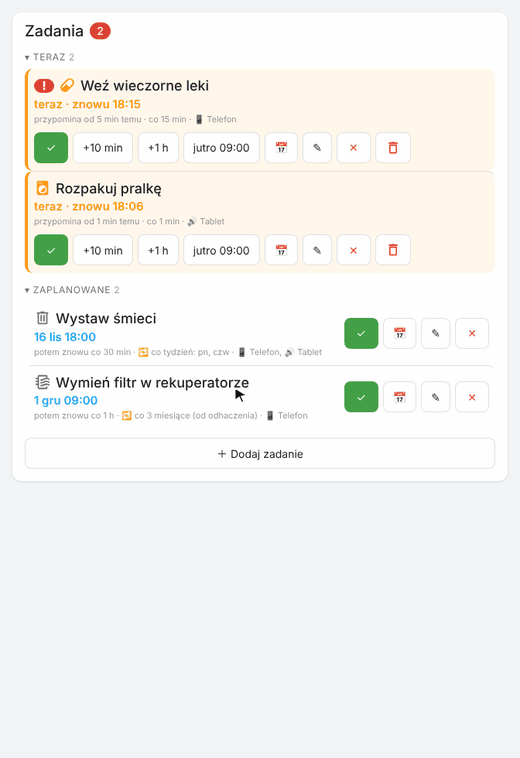
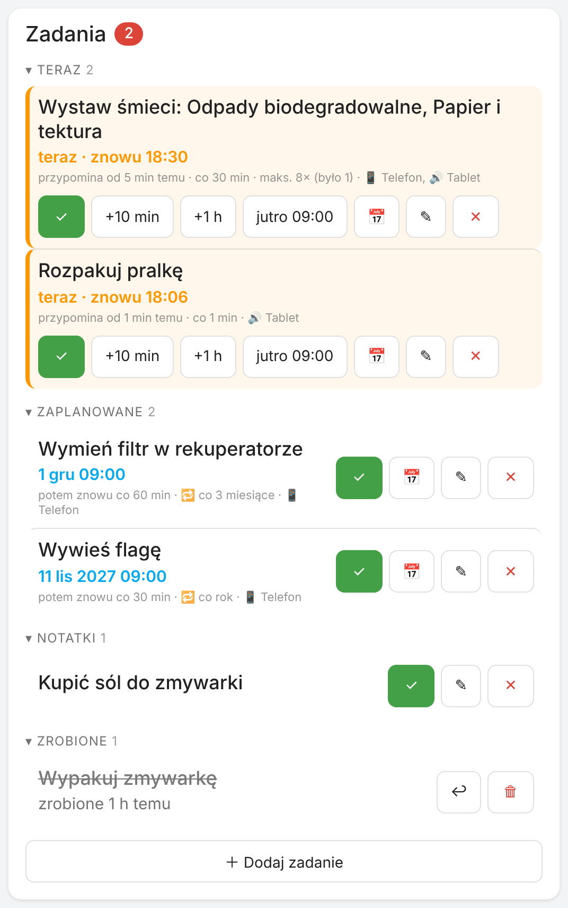
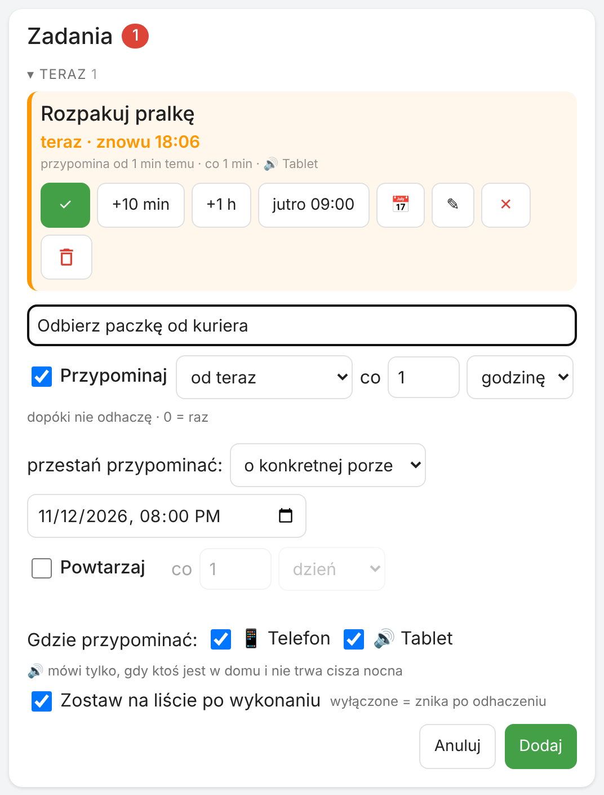
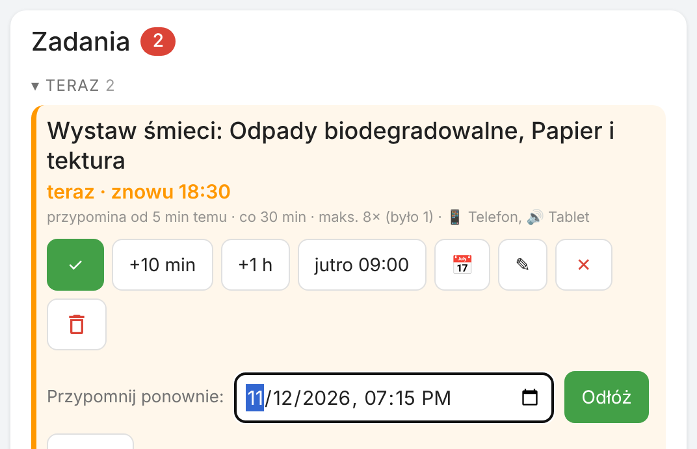
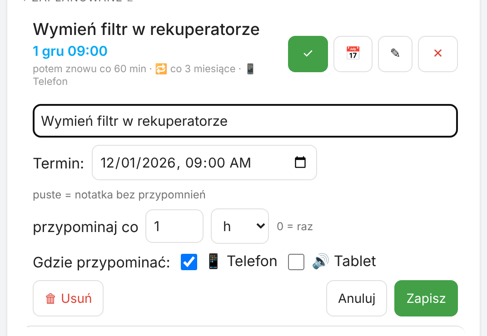

# Remindo — zadania z przypomnieniami dla Home Assistant

🇬🇧 [English](README.md) · 🇵🇱 Polski

Integracja do Home Assistant, która zamienia „pamiętaj, żeby…” w zadania, które **same przypominają**, dopóki ich nie odhaczysz.

- 📋 **Lista zadań** (`todo.remindo`), widoczna też w standardowej karcie To-do i kalendarzu.
- ⏰ **Przypomnienia co X minut/godzin**, aż zareagujesz, z limitem („maks. 3 razy” albo „do 22:00”).
- 📱 **Push na telefony** z przyciskami ✅ Zrobione / ⏰ Odłóż / ❌ Nie robię. Powiadomienie znika ze wszystkich telefonów po każdej akcji.
- 🔊 **Komunikat głosowy** (TTS) na tablecie lub głośniku, tylko gdy ktoś jest w domu i poza ciszą nocną. Komunikaty czekają w kolejce: jeśli głośnik akurat coś mówi (np. inna automatyzacja), Remindo poczeka, aż skończy, zamiast mu przerywać.
- 🔁 **Zadania cykliczne**: co N godzin / dni / tygodni / miesięcy / lat, w wybrane dni tygodnia (pn + czw), co miesiąc w 3. wtorek / ostatni piątek / ostatniego dnia, według stałego kalendarza albo licząc od odhaczenia (np. „filtr rekuperatora co 3 miesiące od faktycznej wymiany”).
- 🤖 **Reguły**: zadanie dodaje się samo, gdy urządzenie osiągnie stan (zmywarka skończyła, brama otwarta 10 min, wilgotność > 70%) albo dzień przed wydarzeniem w kalendarzu (wywóz śmieci). Zamyka się samo, gdy warunek minie.
- 🗂️ **Karta Lovelace** dostarczana z integracją: Teraz / Zaplanowane / Notatki / Zrobione / Odrzucone, odkładanie jednym kliknięciem, ręczne dodawanie zadań.
- 📣 **Dowolne kanały**: aplikacja HA (z przyciskami) oraz Telegram, e-mail, SMS i każde inne powiadomienie, które masz w HA (sam tekst).
- ✅ **Komunikat po załatwieniu**: np. „Brama zamknięta ✅”, gdy zadanie zamknie się samo.
- 🌍 Po polsku, angielsku, niemiecku, francusku, niderlandzku, włosku i hiszpańsku.

<p align="center"></p>

⭐ **Jeśli Remindo Ci się przydaje, zostaw gwiazdkę repozytorium na GitHubie.** Dzięki temu łatwiej trafią na nie inni użytkownicy Home Assistant.

## Instalacja

Wymaga Home Assistant **2026.11** lub nowszego.

### Marketplace (zalecane)
[](https://my.home-assistant.io/redirect/marketplace_repository/?owner=szczukot&repository=ha-remindo&category=integration)

Kliknij przycisk, żeby otworzyć Remindo w swoim Home Assistant, albo:

1. *Ustawienia → **Marketplace***, wyszukaj **Remindo** → **Zainstaluj**.
2. Jeśli Home Assistant poprosi o restart (*Ustawienia → System → Naprawy*), zrestartuj go.
3. *Ustawienia → Urządzenia i usługi → Dodaj integrację → **Remindo*** (Marketplace może otworzyć ten krok sam zaraz po instalacji).

Jeśli wyszukiwarka nie znajduje Remindo, dodaj je ręcznie: *Ustawienia → Marketplace* → menu **⋮** → **Dodaj z linku** → wklej `https://github.com/szczukot/ha-remindo` → **Remindo** → **Zainstaluj**, potem kroki 2–3.

### Ręcznie
Skopiuj folder `custom_components/remindo` do `/config/custom_components/` (np. przez dodatek File editor albo Samba), zrestartuj HA i dodaj integrację **Remindo** jak w kroku 3.

## Konfiguracja

Przy dodawaniu integracji (i później w *Konfiguruj*) ustawiasz:

| Opcja | Opis |
|---|---|
| Kanały powiadomień | aplikacja HA (`notify.mobile_app_*`, z przyciskami) oraz każdy inny kanał z HA: Telegram, e-mail, SMS, encje `notify.*` (sam tekst) |
| Telefony czytające na głos, głośność | tylko Android: wybrane telefony dodatkowo wypowiadają przypomnienie (TTS aplikacji HA), także gdy nikogo nie ma w domu; nie w ciszy nocnej i tylko dla zadań z komunikatem głosowym. Głośność: multimedia albo alarm (słychać też w trybie cichym) |
| Powiadomienie w HA | dodatkowo dzwoneczek w HA, przy każdym przypomnieniu (także dla zadań bez wybranego telefonu i głośnika) |
| Silnik TTS, głośniki/tablety | gdzie mówić komunikaty |
| Język i głos komunikatów | opcjonalnie, np. `pl-PL` i `MarekNeural` (Home Assistant Cloud) albo `pl` (Google Translate) — kod w formacie silnika, podobny (`pl-PL` ↔ `pl`) Remindo samo poprawi; puste = język i głos Twojego asystenta głosowego (*Ustawienia → Asystenci głosowi*), jeśli używa tego samego silnika, a inaczej domyślne silnika (Home Assistant Cloud: angielski amerykański) |
| Włącz ekran tabletu | np. `switch.<tablet>_screen` z Fully Kiosk |
| Obecność | np. `group.domownicy`; głos tylko gdy ktoś jest w domu |
| Cisza nocna | bez komunikatów głosowych; push nadal przychodzi |
| Cisza nocna także dla push | włączone = w nocy nic nie przychodzi; przypomnienie, które wypadnie w ciszy nocnej, poczeka do jej końca |
| Domyślny interwał, godzina dla zadań z samą datą, odłożenie z telefonu | |
| Po kliknięciu powiadomienia otwórz | np. `/lovelace/remindo` |
| Dodatkowe dane powiadomień w aplikacji | zaawansowane: wszystko, co rozumie aplikacja HA, jest dopisywane do każdego powiadomienia, np. `car_ui: true` (Android Auto), `priority: high` + `ttl: 0` (dostarcz natychmiast), `notification_icon`, `color`, `channel`. Można nadpisać w regule i w `remindo.add`. |
| Zostawiaj wykonane zadania na liście | wyłączone = zadanie znika po odhaczeniu (zostaje w dzienniku); można to zmienić dla każdego zadania i reguły |

## Karta

<p align="center"></p>

Ładuje się automatycznie z integracją (bez dodawania zasobu). W „Dodaj kartę” wybierz **Remindo**: lista kart pokazuje podgląd na żywo z Twoimi zadaniami. Opcje ustawisz w edytorze wizualnym (tytuł, przycisk „＋ Dodaj zadanie”, sekcje Zrobione / Odrzucone) albo w YAML. W widoku sekcji karta domyślnie zajmuje całą szerokość; w zakładce *Układ* można ją zwęzić (do połowy).

```yaml
type: custom:remindo-card
title: Zadania     # opcjonalnie, domyślnie „Zadania” / „Tasks”
show_done: true    # sekcje Zrobione / Odrzucone (zwinięte)
show_form: true    # przycisk „＋ Dodaj zadanie”
list: Akwarium     # opcjonalnie: pokazuj i dodawaj tylko tę listę
```

### Ikony

Zadanie może mieć ikonę (ikony `mdi:` z Home Assistant): wybierzesz ją w formularzu zadania („Ikona:”), w pierwszym kroku reguły albo podasz `icon: mdi:package-variant` w `remindo.add`. Ikona stoi przed treścią zadania na karcie i zastępuje ikonę aplikacji w powiadomieniu na Androidzie (iOS pokazuje sam tekst). Emoji wpisane w treść działa wszędzie, także na liście To-do.

### Zapowiedź (przypomnienie wcześniej)

Przy zadaniu z terminem w polu **Zapowiedź** wybierz 15 min, 30 min, 1 h, 2 h albo 24 h przed terminem, albo **o godzinie…** (np. dzień wcześniej o 20:00). O tym czasie przychodzi jedno powiadomienie, np. „Jutro o 14:30: Dentysta”, z przyciskami Zrobione i Nie robię. Termin zadania się nie zmienia, a od niego zaczyna się zwykłe przypominanie co N minut. Jeśli odhaczysz zadanie już przy zapowiedzi, przypominania w terminie nie będzie. Zadanie cykliczne dostaje zapowiedź przed każdym terminem. Zapowiedź przestrzega „ciszy nocnej także dla push”. W `remindo.add` / `remindo.update`: `advance` (minuty) albo `advance_at` (godzina) + `advance_days` (ile dni przed, domyślnie 1).

### Ważne

Zaznacz **❗ Ważne** w formularzu zadania, w kroku przypomnień reguły albo podaj `important: true` w `remindo.add`, dla rzeczy, których nie wolno przegapić (zalanie, leki, piekarnik). Telefon dzwoni wtedy głośno: Android odtwarza powiadomienie jak alarm, także przy wyciszonym telefonie; iPhone pokazuje je jako alert krytyczny, także w trybie „Nie przeszkadzać” (raz zezwól aplikacji HA na alerty krytyczne w jej ustawieniach powiadomień). Push ważnego zadania przychodzi także w ciszy nocnej; komunikat głosowy nadal jej przestrzega. Na karcie zadanie ma czerwony znak **!**.

### Listy

Na start jest jedna, ogólna lista i karta wygląda jak powyżej. Żeby trzymać osobno np. zadania akwarium, wpisz nazwę listy w formularzu zadania („Lista:”, z podpowiedziami list w użyciu), w regule albo w `remindo.add` (`list: Akwarium`). Wielkość liter nie ma znaczenia. Gdy jest choć jedna lista:

- karta pokazująca wszystko dostaje u góry przyciski filtra (*Wszystkie · Akwarium · Ogród*), a przy każdym zadaniu małą etykietę z nazwą listy;
- karta ustawiona na jedną listę („Pokaż tylko listę” w edytorze wizualnym albo `list: Akwarium` w YAML) pokazuje i dodaje tylko zadania tej listy, bez filtra; jej tytuł to domyślnie nazwa listy.

`todo.remindo` zawiera wszystkie zadania ze wszystkich list.

Formularz dodawania:

<p align="center"></p>

Odznaczone „Przypominaj” = zwykła notatka na liście. Odznaczone „Zostaw na liście po wykonaniu” = zadanie zniknie po odhaczeniu (cykliczne zostają zawsze).

<p align="center"></p>

Przyciski przy zadaniu: **✓** zrobione, **📅** przypomnij w wybranym terminie, **✎** zmień, **✕** nie robię (trafia do *Odrzuconych*, da się przywrócić), **🗑** usuń bez śladu (kliknij dwa razy). Zadania, które właśnie przypominają, mają też szybkie odkładanie. Zadanie cykliczne nie ma **🗑** w wierszu: **✕** pomija tylko ten termin, a zadanie wraca w następnym; żeby usunąć je razem ze wszystkimi kolejnymi terminami, otwórz **✎** i wybierz **Usuń**. Zadanie odhaczone albo odrzucone przez pomyłkę da się przywrócić: rozwiń *Zrobione* albo *Odrzucone* i naciśnij **↩** (od razu znowu przypomina); **🗑** usuwa je z listy.

<p align="center"></p>

**✎** otwiera ten sam formularz co dodawanie zadania, wypełniony wartościami zadania: można zmienić treść, termin, odstęp przypomnień, kiedy przestać przypominać, powtarzanie, miejsce przypominania i pozostawienie po wykonaniu. Naraz otwarty jest tylko jeden formularz.

Odkładanie zadania: **+10 min**, **+1 h**, **jutro 09:00** (godzina z opcji „godzina dla zadań z samą datą”) albo **📅** dowolny dzień i godzinę. Odłożenie przesuwa tylko najbliższe przypomnienie: potem zadanie znowu przypomina w swoim zwykłym rytmie (np. co 5 min), aż je odhaczysz. Zadania cykliczne zachowują swój harmonogram; po odhaczeniu wracają w następnym terminie. Jeśli zadanie cykliczne ma „przestań przypominać o konkretnej porze” i nikt go do tej pory nie odhaczy, ten termin liczy się jako pominięty, a zadanie czeka na następny. Odłożenie poza tę porę nie przepada: zadanie przypomni o odłożonej godzinie, a koniec przypominania przesuwa się razem z nim, tylko dla tego terminu (zostaje tyle czasu, ile było, co najmniej godzina).

Powtarzanie w formularzu zadania: **co N tygodni** można ograniczyć do wybranych dni (zaznacz np. pn i czw); **co N miesięcy** może wypadać tego samego dnia miesiąca, w ten sam dzień tygodnia („w 3. wtorek”), w ostatni taki dzień tygodnia albo ostatniego dnia miesiąca — wszystko według terminu. **Licz od odhaczenia** liczy następny termin od chwili odhaczenia (o zwykłej godzinie), a nie według stałego kalendarza: odhaczony cztery dni później filtr wróci trzy miesiące od tego dnia.

Karta wyświetla się w języku profilu użytkownika.

## Reguły (zadania dodawane automatycznie)

*Ustawienia → Urządzenia i usługi → Remindo → **＋ Dodaj regułę***. Trzy kroki:

1. **Kiedy**: treść zadania, encja, warunek (*ma stan* / *powyżej* / *poniżej* / *jest niedostępne* / *wydarzenie w kalendarzu*).
2. **Warunek**: wartość (lista stanów encji) i „przez co najmniej N min”; dla kalendarza: **N dni przed, o godzinie** (jedno zadanie z wydarzeniami danego dnia, także całodniowymi) albo **N minut przed początkiem** (osobne zadanie dla każdego wydarzenia z godziną: zapowiedź N minut przed, przypominanie od początku, samo zamyka się po końcu wydarzenia; przesunięte albo usunięte wydarzenie zabiera swoje zadanie); dla *jest niedostępne*: jak długo (co najmniej 10 min, bo po restarcie encje przez chwilę są niedostępne).
3. **Przypomnienia**: ponawianie, limit, kanały, głośniki, „zamknij samo, gdy warunek minie”, komunikat po załatwieniu, „zostaw na liście po wykonaniu”. Opcjonalnie: **tekst mówiony** (co powie głośnik zamiast treści zadania, np. „To ja, Twoja zmywarka. Otwórz mnie, proszę.”) i dodatkowe dane powiadomienia dla tej reguły.

**Wartość w treści, bez szablonów.** W treści reguły (i w komunikacie po załatwieniu) możesz wpisać:

| Znacznik | Co wstawia | Przykład |
|---|---|---|
| `{state}` | aktualną wartość z jednostką | „Wilgotność {state}, przewietrz łazienkę” → „Wilgotność 78 %, przewietrz łazienkę” |
| `{name}` | nazwę urządzenia | „{name} otwarte za długo” → „Brama garażowa otwarte za długo” |
| `{event}` | (kalendarz) nazwy wydarzeń | „Jutro wywóz: {event}” |
| `{time}` | (kalendarz) godzina początku | „{event} o {time}” → „Dentysta o 14:30” |
| `{location}` | (kalendarz) miejsce | „{event}, {location}” |

Wartość odświeża się przy każdym przypomnieniu. Kto zna szablony HA, może też użyć `{{ ... }}` (w regułach oraz w `remindo.add` wywołanym z automatyzacji albo przez administratora; tekst wpisany przez innych użytkowników albo pochodzący z kalendarza nigdy nie jest wykonywany jako szablon), np. „Na dworze {{ states('sensor.temperatura_zewn') }}°C”.

Przykłady:

| Reguła | Ustawienia |
|---|---|
| Wypakuj zmywarkę | `sensor.zmywarka_operation_state` ma stan `finished`; zamyka się samo po otwarciu |
| Zamknij bramę garażową | `binary_sensor.brama` ma stan `on` przez 10 min; co 10 min, maks. 6 razy |
| Wystaw śmietnik | `calendar.odpady`, 1 dzień przed, 18:00 → „Wystaw śmietnik: Papier, Szkło” (albo wstaw `{event}` w treść, żeby nazwa wydarzenia trafiła w konkretne miejsce) |
| Dentysta i inne wizyty | `calendar.google`, N minut przed początkiem, 60 min → godzinę wcześniej „Dziś o 14:30: Dentysta”. Wydarzenie może mieć własny czas: wpisz w jego opisie w Google np. `remindo: 2h` (albo `30m`, `1d`). Przypomnień ustawionych w Google HA nie odczytuje. |
| Przewietrz łazienkę | `sensor.wilgotnosc_lazienka` powyżej 70 przez 15 min |
| Czujnik furtki nie działa | `binary_sensor.furtka` jest niedostępne przez 2 h → „{name} offline, sprawdź baterię”; zamyka się samo, gdy czujnik wróci |

Przejście przez `unavailable` / `unknown` (restart HA, zanik Wi-Fi) samo nigdy nie wyzwala reguły, ale też nie ukrywa prawdziwej zmiany: „pracuje → niedostępna → skończyła” nadal się liczy.

Odliczanie „przez co najmniej N min” przetrwa restart Home Assistant. Sprawdzenie kalendarza, które przepadło, bo Home Assistant nie działał, wykona się po starcie. Zadanie z kalendarza, którego nikt nie odhaczył, znika po dniu wydarzenia. Usunięcie reguły zamyka też jej otwarte zadanie.

Jeśli reguła obserwuje encję, której już nie ma (zmiana nazwy albo usunięcie), albo porównuje tekstowy stan z liczbą, Home Assistant pokaże ostrzeżenie w *Ustawienia → System → Naprawy*. Formularz reguły nie pozwoli takiej reguły zapisać.

## Przykłady zastosowań

### Przykładowy zestaw

| Sytuacja | Ustawienia |
|---|---|
| 🧺 Pralka skończyła | reguła: `sensor.pralka` ma stan `off` → „Rozpakuj pralkę”, tablet co 1 min, aż odhaczysz; nie zostaje na liście |
| 🍽️ Zmywarka skończyła | reguła: `sensor.zmywarka_…_operation_state` ma stan `finished`, co 30 min; zamyka się sama po otwarciu drzwi |
| 🗑️ Wywóz śmieci | reguła kalendarzowa na kalendarzu z Waste Collection Schedule: 1 dzień przed o 18:00 → „Wystaw śmieci: Papier i tektura”, push + tablet, co 30 min, maks. 8 razy |
| 🇵🇱 Flaga | zadanie z karty: 11.11 o 9:00, powtarzaj co 1 rok |
| 🚗 Ubezpieczenie auta | zadanie z karty: 10.12, powtarzaj co 1 rok, przypominaj co 1 dzień, aż odhaczysz |

### Dom i AGD

| Sytuacja | Ustawienia |
|---|---|
| 🧺 Suszarka skończyła | jak pralka: stan programu `finished` / moc gniazdka poniżej 5 W przez 3 min |
| 🧂 Sól / nabłyszczacz w zmywarce | reguła na czujniku z integracji zmywarki (np. Home Connect) ma stan `on` → „Dosyp soli do zmywarki” |
| 🧊 Lodówka/zamrażarka otwarta | reguła: czujnik drzwi `on` przez 2 min → tablet co 1 min, komunikat po zamknięciu „Lodówka zamknięta ✅” |
| 🤖 Odkurzacz utknął | reguła: stan odkurzacza `error` → „Uratuj odkurzacz: {name}” |
| ☕ Odkamienianie ekspresu | zadanie cykliczne co 2 miesiące |
| 🪥 Wymiana szczoteczki / filtra wody | zadanie cykliczne co 3 miesiące, z samą datą |
| 🪴 Podlewanie kwiatów | zadanie cykliczne co 4 dni, tylko na listę (bez przypominania) |

### Bezpieczeństwo i wyjścia

| Sytuacja | Ustawienia |
|---|---|
| 🚪 Brama garażowa / wjazdowa / furtka otwarta za długo | reguła: `on` przez 10 min, co 10 min, maks. 6 razy, komunikat po załatwieniu „{name} zamknięta ✅” |
| 🛡️ Alarm nieuzbrojony na noc | reguła: stan alarmu `disarmed` + automatyzacja o 23:00 wywołująca `remindo.add` (albo reguła na pomocniku „noc”) |
| 🪟 Okno otwarte, a działa klimatyzacja/ogrzewanie | reguła na czujniku okna `on` przez 5 min → „Zamknij okno, {name}”; zamyka się samo |
| 🔑 Drzwi wejściowe niezamknięte na klucz | reguła na zamku `unlocked` przez 15 min |

### Ogrzewanie, klimatyzacja, energia

| Sytuacja | Ustawienia |
|---|---|
| 🔥 Niskie ciśnienie w kotle | reguła: ciśnienie (np. z eBUSd) poniżej 1.0 → „Dopompuj wodę w kotle: {state}” |
| ❄️ Filtry klimatyzatorów | zadanie cykliczne co 3 miesiące |
| 🛠️ Przegląd kotła / pompy ciepła | zadanie cykliczne co rok |
| 🇵🇱 Wywieś flagę w święto | zadanie cykliczne co rok, od 2 dni wcześniej o 9:00, raz dziennie, przestań przypominać o 20:00 w dniu święta |
| 📟 Odczyt gazomierza / wodomierza | zadanie cykliczne co miesiąc, 1. dnia o 9:00 |
| 🔋 Słaba bateria w czujniku | reguła: bateria poniżej 15 → „Wymień baterię: {name} ({state})” |
| 📱 Tablet się rozładowuje | reguła: bateria tabletu poniżej 20 → „Podłącz tablet” |

### Rzeczy jednorazowe (ręcznie z karty)

| Sytuacja | Ustawienia |
|---|---|
| 📦 Kurier ma dziś przyjść | „Odbierz paczkę” od 9:00, co 1 h, przestań o 18:00 |
| 📞 Oddzwoń do kogoś | +1 h, przypomnij raz |
| 🛒 Kupić coś przy okazji | notatka (bez przypominania) |

## Usługi (do automatyzacji i skryptów)

| Usługa | Pola |
|---|---|
| `remindo.add` | `summary`, `description`, `start` (`now` / data / data z godziną / puste = notatka), `interval` (min, 0 = raz), `max_reminders`, `remind_until`, `key`, `repeat` (`none`/`hourly`/`daily`/`weekly`/`monthly`/`yearly`), `repeat_every`, `repeat_days` (`mon`…`sun`), `repeat_on` (`day`/`weekday`/`last_weekday`/`last_day`), `repeat_from_done`, `phones`, `speakers`, `tts_message`, `push`, `tts`, `keep_done` (zostaw po wykonaniu), `notify_data` (dodatkowe dane powiadomienia w aplikacji), `list` (np. `Akwarium`), `icon` (np. `mdi:package-variant`), `important` (głośny alarm / alert krytyczny, także w ciszy nocnej), `advance` (zapowiedź N minut przed terminem) albo `advance_at` + `advance_days` (zapowiedź o godzinie, N dni przed), `done_message` (komunikat po zamknięciu przez `close_by_key`/regułę). W `summary`, `tts_message` i `done_message` działają szablony HA. Zwraca `uid`. |
| `remindo.update` | otwarte zadanie: `uid`/`key` + dowolne z: `summary`, `description`, `start`, `interval`, `repeat`, `repeat_every`, `repeat_days`, `repeat_on`, `repeat_from_done`, `phones`, `speakers`, `max_reminders`, `remind_until`, `keep_done`, `notify_data`, `list`, `icon`, `important`, `advance`, `advance_at`, `advance_days`. Zmieniają się tylko wysłane pola; `null` czyści pole. |
| `remindo.done`, `remindo.dismiss` | `uid` albo `key`. Zadanie cykliczne obie przesuwają na następny termin; drugie zamknięcie w ciągu 30 s (inny telefon, karta) jest pomijane, więc termin nie przepada przypadkiem. |
| `remindo.reopen` | `uid`: otwiera ponownie zadanie zrobione albo odrzucone; zadanie z terminem od razu znowu przypomina |
| `remindo.delete` | `uid` albo `key`: usuwa zadanie na stałe, także cykliczne |
| `remindo.snooze` | `uid`/`key` + `minutes` albo `until` |
| `remindo.close_by_key` | `key`: zamyka zadanie (np. brama się zamknęła); wysyła `done_message`, jeśli był |

```yaml
action: remindo.add
data:
  summary: Wymień filtr w rekuperatorze
  start: "2026-12-01"
  repeat: monthly
  repeat_every: 3
  phones: [notify.mobile_app_telefon]
  speakers: []
```

Przypomnienia, które wypadły, gdy Home Assistant był wyłączony, przychodzą ok. 30 sekund po jego starcie.

## Encje i zdarzenia

- `todo.remindo` (widoczna jako *Remindo*): lista. Jej stan to liczba otwartych zadań, jak w każdej liście To-do w Home Assistant. Odhaczenie w zwykłej karcie To-do zamyka zadanie i czyści powiadomienia.
- `sensor.remindo_active` (widoczna jako *Remindo – przypomina teraz*): ile zadań przypomina w tej chwili, czyli jest w sekcji *Teraz* na karcie (atrybut `tasks` z nazwami, `scheduled` z liczbą zadań czekających na swój termin). Przydaje się np. do plakietki na dashboardzie albo do „pokaż stronę z zadaniami, gdy coś przypomina”.
- `calendar.remindo` (widoczna jako *Remindo*): kalendarz tylko do odczytu z otwartymi zadaniami, które mają termin, więc widać je na każdej karcie kalendarza. Zadanie trwa do „przestań przypominać”, a bez tego godzinę; zadanie cykliczne jest na każdym terminie (zadania co N godzin tylko na najbliższym). Reguła kalendarzowa nie może obserwować tego kalendarza (dodawałaby zadania z zadań).
- zdarzenia `remindo_created`, `remindo_reminded`, `remindo_done`, `remindo_snoozed`, `remindo_dismissed`, opisane w dzienniku.

### Własna reakcja na przypomnienie

Remindo wysyła powiadomienia i mówi; resztę robisz po swojemu. Każde zdarzenie niesie `uid`, `summary`, `key` i `source` (`remindo_reminded` także `count`), więc zwykła automatyzacja może na nie zareagować: pokazać stronę na tablecie, mignąć światłem, zagrać dźwięk.

```yaml
alias: Remindo - pokaż listę zadań na tablecie
triggers:
  - trigger: event
    event_type: remindo_reminded
actions:
  - action: fully_kiosk.load_url        # albo browser_mod.navigate, light.turn_on, …
    target:
      device_id: TWOJ_TABLET
    data:
      url: http://homeassistant.local:8123/lovelace/remindo
```

Żeby reagować tylko na jedno zadanie, dodaj warunek na treść, np. `{{ 'zmywark' in trigger.event.data.summary | lower }}`.

## Język

Remindo mówi **po polsku, angielsku, niemiecku, francusku, niderlandzku, włosku i hiszpańsku** (ekrany konfiguracji, usługi, komunikaty błędów, karta, przyciski push i dziennik). Push, dziennik i opis w liście To-do idą w języku ustawionym w *Ustawienia → System → Ogólne*; karta w języku profilu użytkownika. Każdy inny język dostaje angielski.

Niemiecki, francuski, niderlandzki, włoski i hiszpański zostały przetłumaczone bez native speakera, więc coś może brzmieć niezgrabnie: poprawki bardzo mile widziane jako pull request (albo issue z lepszym tekstem).

**Dodanie języka** to trzy pliki nazwane kodem języka (np. `cs.json`), skopiowane z angielskich i przetłumaczone:

| Plik | Co obejmuje |
|---|---|
| `custom_components/remindo/translations/<kod>.json` | ustawienia, formularz reguły, usługi, błędy, Naprawy (format samego Home Assistant) |
| `custom_components/remindo/frontend/i18n/<kod>.json` | karta |
| `custom_components/remindo/messages/<kod>.json` | przyciski push, dziennik, opis powtarzania w liście To-do |

Jednostki mają osobny wpis dla każdej formy liczby mnogiej języka (`one`, `few`, `many`, `other`, jak w [CLDR](https://cldr.unicode.org/index/cldr-spec/plural-rules)); tam, gdzie „co” zmienia się z jednostką, dodaj `every_one` / `every_n` (np. niemieckie `"jeden Tag"`, `"alle {n} Tage"`). Testy sprawdzają, że każdy język ma każdy tekst z tymi samymi `{zmiennymi}`.

## Rozwój

```bash
pip install -r requirements_test.txt   # Python 3.14
pytest
```

Przy każdym pushu GitHub uruchamia testy, ruff, hassfest i walidację repozytorium. Wydanie powstaje samo po wypchnięciu tagu `vX.Y.Z` (musi zgadzać się z `version` w `manifest.json`).

## Licencja

MIT
