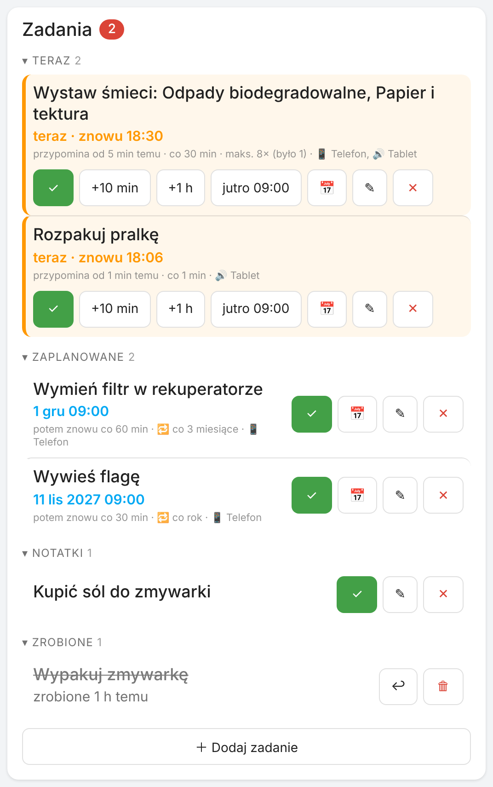
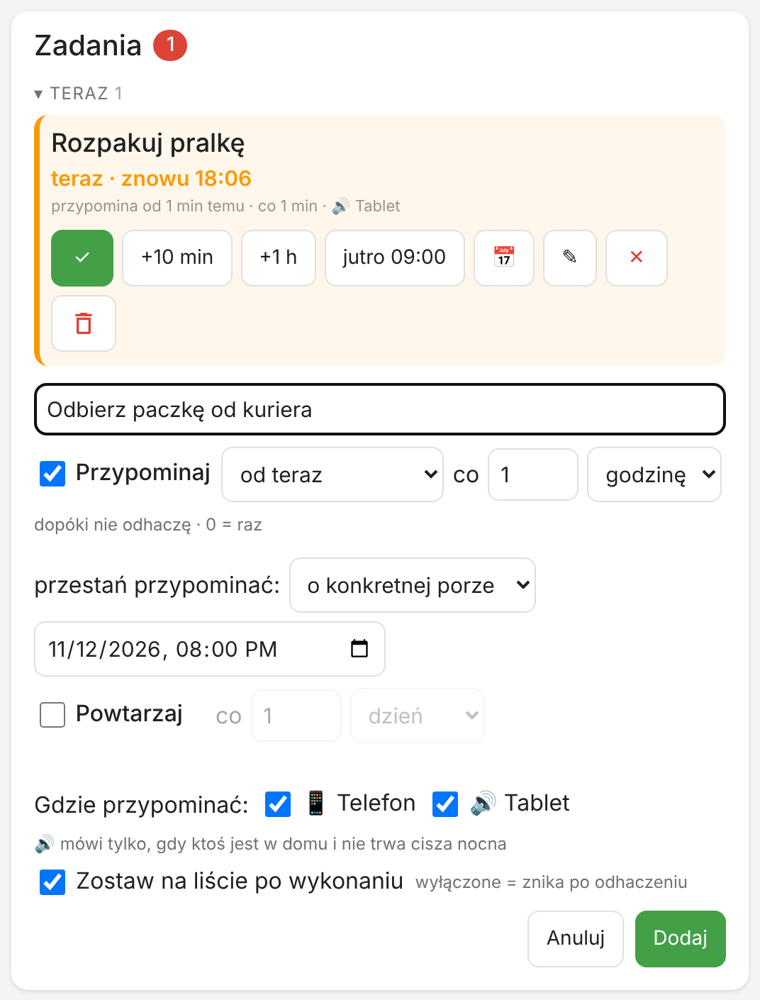
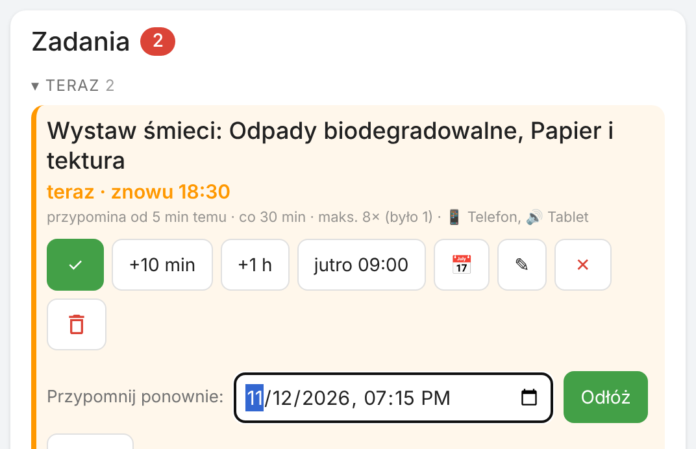
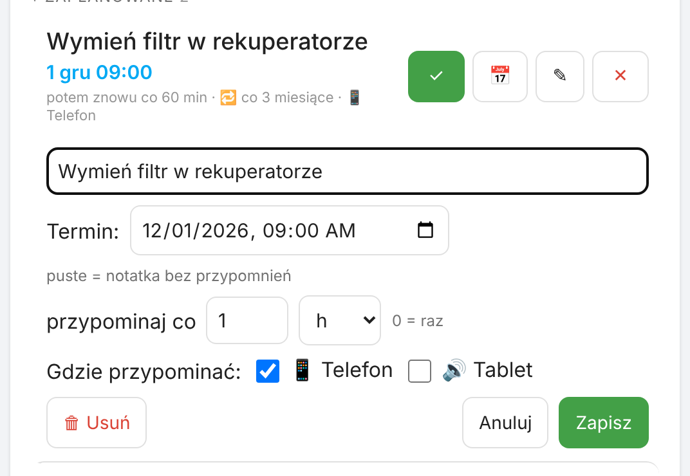

# Remindo — zadania z przypomnieniami dla Home Assistant

🇬🇧 [English](README.md) · 🇵🇱 Polski

Integracja do Home Assistant, która zamienia „pamiętaj, żeby…” w zadania, które **same przypominają**, dopóki ich nie odhaczysz.

- 📋 **Lista zadań** (`todo.remindo`), widoczna też w standardowej karcie To-do i kalendarzu.
- ⏰ **Przypomnienia co X minut/godzin**, aż zareagujesz, z limitem („maks. 3 razy” albo „do 22:00”).
- 📱 **Push na telefony** z przyciskami ✅ Zrobione / ⏰ Odłóż / ❌ Nie robię. Powiadomienie znika ze wszystkich telefonów po każdej akcji.
- 🔊 **Komunikat głosowy** (TTS) na tablecie lub głośniku, tylko gdy ktoś jest w domu i poza ciszą nocną. Komunikaty czekają w kolejce: jeśli głośnik akurat coś mówi (np. inna automatyzacja), Remindo poczeka, aż skończy, zamiast mu przerywać.
- 🔁 **Zadania cykliczne**: co N godzin / dni / tygodni / miesięcy / lat (np. „filtr rekuperatora co 3 miesiące”).
- 🤖 **Reguły**: zadanie dodaje się samo, gdy urządzenie osiągnie stan (zmywarka skończyła, brama otwarta 10 min, wilgotność > 70%) albo dzień przed wydarzeniem w kalendarzu (wywóz śmieci). Zamyka się samo, gdy warunek minie.
- 🗂️ **Karta Lovelace** dostarczana z integracją: Teraz / Zaplanowane / Notatki / Zrobione / Odrzucone, odkładanie jednym kliknięciem, ręczne dodawanie zadań.
- 📣 **Dowolne kanały**: aplikacja HA (z przyciskami) oraz Telegram, e-mail, SMS i każde inne powiadomienie, które masz w HA (sam tekst).
- ✅ **Komunikat po załatwieniu**: np. „Brama zamknięta ✅”, gdy zadanie zamknie się samo.
- 🌍 Po polsku i angielsku.

<p align="center"></p>

## Instalacja

Wymaga Home Assistant **2026.11** lub nowszego.

### Marketplace (zalecane)
1. *Ustawienia → **Marketplace*** → menu **⋮** → **Dodaj z linku**.
2. Wklej `https://github.com/szczukot/ha-remindo` → **Remindo** → **Zainstaluj**.
3. Jeśli Home Assistant poprosi o restart (*Ustawienia → System → Naprawy*), zrestartuj go.
4. *Ustawienia → Urządzenia i usługi → Dodaj integrację → **Remindo*** (Marketplace może otworzyć ten krok sam zaraz po instalacji).

### Ręcznie
Skopiuj folder `custom_components/remindo` do `/config/custom_components/` (np. przez dodatek File editor albo Samba), zrestartuj HA i dodaj integrację **Remindo** jak w kroku 4.

## Konfiguracja

Przy dodawaniu integracji (i później w *Konfiguruj*) ustawiasz:

| Opcja | Opis |
|---|---|
| Kanały powiadomień | aplikacja HA (`notify.mobile_app_*`, z przyciskami) oraz każdy inny kanał z HA: Telegram, e-mail, SMS, encje `notify.*` (sam tekst) |
| Powiadomienie w HA | dodatkowo dzwoneczek w HA |
| Silnik TTS, głośniki/tablety | gdzie mówić komunikaty |
| Włącz ekran tabletu | np. `switch.<tablet>_screen` z Fully Kiosk |
| Obecność | np. `group.domownicy`; głos tylko gdy ktoś jest w domu |
| Cisza nocna | bez komunikatów głosowych; push nadal przychodzi |
| Cisza nocna także dla push | włączone = w nocy nic nie przychodzi; przypomnienie, które wypadnie w ciszy nocnej, poczeka do jej końca |
| Domyślny interwał, godzina dla zadań z samą datą, odłożenie z telefonu | |
| Po kliknięciu powiadomienia otwórz | np. `/lovelace/remindo` |
| Dodatkowe dane powiadomień w aplikacji | zaawansowane: wszystko, co rozumie aplikacja HA, jest dopisywane do każdego powiadomienia, np. `car_ui: true` (Android Auto), `priority: high` + `ttl: 0` (dostarcz natychmiast), `notification_icon`, `color`, `channel`. Można nadpisać w regule i w `remindo.add`. |
| Zostawiaj wykonane zadania na liście | wyłączone = zadanie znika po odhaczeniu (zostaje w dzienniku); można to zmienić dla każdego zadania i reguły |

## Karta

Ładuje się automatycznie z integracją (bez dodawania zasobu). W „Dodaj kartę” wybierz **Remindo**:

```yaml
type: custom:remindo-card
title: Zadania     # opcjonalnie, domyślnie „Zadania” / „Tasks”
show_done: true    # sekcje Zrobione / Odrzucone (zwinięte)
show_form: true    # przycisk „＋ Dodaj zadanie”
```

Formularz dodawania:

<p align="center"></p>

Odznaczone „Przypominaj” = zwykła notatka na liście. Odznaczone „Zostaw na liście po wykonaniu” = zadanie zniknie po odhaczeniu (cykliczne zostają zawsze).

<p align="center"></p>

Przyciski przy zadaniu: **✓** zrobione, **📅** przypomnij w wybranym terminie, **✎** zmień, **✕** nie robię. Zadania, które właśnie przypominają, mają też szybkie odkładanie. Przy zadaniu cyklicznym **✕** tylko pomija ten termin; żeby usunąć je na stałe, otwórz **✎** i wybierz **Usuń**.

<p align="center"></p>

**✎** pozwala zmienić treść, termin, odstęp przypomnień i miejsce przypominania.

Odkładanie zadania: **+10 min**, **+1 h**, **jutro 09:00** (godzina z opcji „godzina dla zadań z samą datą”) albo **📅** dowolny dzień i godzinę. Odłożenie przesuwa tylko najbliższe przypomnienie: potem zadanie znowu przypomina w swoim zwykłym rytmie (np. co 5 min), aż je odhaczysz. Zadania cykliczne zachowują swój harmonogram; po odhaczeniu wracają w następnym terminie.

Karta wyświetla się w języku profilu użytkownika.

## Reguły (zadania dodawane automatycznie)

*Ustawienia → Urządzenia i usługi → Remindo → **＋ Dodaj regułę***. Trzy kroki:

1. **Kiedy**: treść zadania, encja, warunek (*ma stan* / *powyżej* / *poniżej* / *wydarzenie w kalendarzu*).
2. **Warunek**: wartość (lista stanów encji) i „przez co najmniej N min”; dla kalendarza: ile dni przed i o której.
3. **Przypomnienia**: ponawianie, limit, kanały, głośniki, „zamknij samo, gdy warunek minie”, komunikat po załatwieniu, „zostaw na liście po wykonaniu”. Opcjonalnie: **tekst mówiony** (co powie głośnik zamiast treści zadania, np. „To ja, Twoja zmywarka. Otwórz mnie, proszę.”) i dodatkowe dane powiadomienia dla tej reguły.

**Wartość w treści, bez szablonów.** W treści reguły (i w komunikacie po załatwieniu) możesz wpisać:

| Znacznik | Co wstawia | Przykład |
|---|---|---|
| `{state}` | aktualną wartość z jednostką | „Wilgotność {state}, przewietrz łazienkę” → „Wilgotność 78 %, przewietrz łazienkę” |
| `{name}` | nazwę urządzenia | „{name} otwarte za długo” → „Brama garażowa otwarte za długo” |
| `{event}` | (kalendarz) nazwy wydarzeń | „Jutro wywóz: {event}” |

Wartość odświeża się przy każdym przypomnieniu. Kto zna szablony HA, może też użyć `{{ ... }}` (w regułach oraz w `remindo.add` wywołanym z automatyzacji albo przez administratora; tekst wpisany przez innych użytkowników albo pochodzący z kalendarza nigdy nie jest wykonywany jako szablon), np. „Na dworze {{ states('sensor.temperatura_zewn') }}°C”.

Przykłady:

| Reguła | Ustawienia |
|---|---|
| Wypakuj zmywarkę | `sensor.zmywarka_operation_state` ma stan `finished`; zamyka się samo po otwarciu |
| Zamknij bramę garażową | `binary_sensor.brama` ma stan `on` przez 10 min; co 10 min, maks. 6 razy |
| Wystaw śmietnik | `calendar.odpady`, 1 dzień przed, 18:00 → „Wystaw śmietnik: Papier, Szkło” (albo wstaw `{event}` w treść, żeby nazwa wydarzenia trafiła w konkretne miejsce) |
| Przewietrz łazienkę | `sensor.wilgotnosc_lazienka` powyżej 70 przez 15 min |

Przejście przez `unavailable` / `unknown` (restart HA, zanik Wi-Fi) samo nigdy nie wyzwala reguły, ale też nie ukrywa prawdziwej zmiany: „pracuje → niedostępna → skończyła” nadal się liczy.

Odliczanie „przez co najmniej N min” przetrwa restart Home Assistant. Sprawdzenie kalendarza, które przepadło, bo Home Assistant nie działał, wykona się po starcie. Zadanie z kalendarza, którego nikt nie odhaczył, znika po dniu wydarzenia.

## Przykłady zastosowań

### Przykładowy zestaw

| Sytuacja | Ustawienia |
|---|---|
| 🧺 Pralka skończyła | reguła: `sensor.pralka` ma stan `off` → „Rozpakuj pralkę”, tablet co 1 min, aż odhaczysz; nie zostaje na liście |
| 🍽️ Zmywarka skończyła | reguła: `sensor.zmywarka_…_operation_state` ma stan `finished`, co 30 min; zamyka się sama po otwarciu drzwi |
| 🗑️ Wywóz śmieci | reguła kalendarzowa na kalendarzu z Waste Collection Schedule: 1 dzień przed o 18:00 → „Wystaw śmieci: Papier i tektura”, push + tablet, co 30 min, maks. 8 razy |
| 🇵🇱 Flaga | zadanie z karty: 11.11 o 9:00, powtarzaj co 1 rok |
| 🚗 Ubezpieczenie auta | zadanie z karty: 10.12, powtarzaj co 1 rok, przypominaj co 1 dzień, aż odhaczysz |

### Dom i AGD

| Sytuacja | Ustawienia |
|---|---|
| 🧺 Suszarka skończyła | jak pralka: stan programu `finished` / moc gniazdka poniżej 5 W przez 3 min |
| 🧂 Sól / nabłyszczacz w zmywarce | reguła na czujniku z integracji zmywarki (np. Home Connect) ma stan `on` → „Dosyp soli do zmywarki” |
| 🧊 Lodówka/zamrażarka otwarta | reguła: czujnik drzwi `on` przez 2 min → tablet co 1 min, komunikat po zamknięciu „Lodówka zamknięta ✅” |
| 🤖 Odkurzacz utknął | reguła: stan odkurzacza `error` → „Uratuj odkurzacz: {name}” |
| ☕ Odkamienianie ekspresu | zadanie cykliczne co 2 miesiące |
| 🪥 Wymiana szczoteczki / filtra wody | zadanie cykliczne co 3 miesiące, z samą datą |
| 🪴 Podlewanie kwiatów | zadanie cykliczne co 4 dni, tylko na listę (bez przypominania) |

### Bezpieczeństwo i wyjścia

| Sytuacja | Ustawienia |
|---|---|
| 🚪 Brama garażowa / wjazdowa / furtka otwarta za długo | reguła: `on` przez 10 min, co 10 min, maks. 6 razy, komunikat po załatwieniu „{name} zamknięta ✅” |
| 🛡️ Alarm nieuzbrojony na noc | reguła: stan alarmu `disarmed` + automatyzacja o 23:00 wywołująca `remindo.add` (albo reguła na pomocniku „noc”) |
| 🪟 Okno otwarte, a działa klimatyzacja/ogrzewanie | reguła na czujniku okna `on` przez 5 min → „Zamknij okno, {name}”; zamyka się samo |
| 🔑 Drzwi wejściowe niezamknięte na klucz | reguła na zamku `unlocked` przez 15 min |

### Ogrzewanie, klimatyzacja, energia

| Sytuacja | Ustawienia |
|---|---|
| 🔥 Niskie ciśnienie w kotle | reguła: ciśnienie (np. z eBUSd) poniżej 1.0 → „Dopompuj wodę w kotle: {state}” |
| ❄️ Filtry klimatyzatorów | zadanie cykliczne co 3 miesiące |
| 🛠️ Przegląd kotła / pompy ciepła | zadanie cykliczne co rok |
| 📟 Odczyt gazomierza / wodomierza | zadanie cykliczne co miesiąc, 1. dnia o 9:00 |
| 🔋 Słaba bateria w czujniku | reguła: bateria poniżej 15 → „Wymień baterię: {name} ({state})” |
| 📱 Tablet się rozładowuje | reguła: bateria tabletu poniżej 20 → „Podłącz tablet” |

### Rzeczy jednorazowe (ręcznie z karty)

| Sytuacja | Ustawienia |
|---|---|
| 📦 Kurier ma dziś przyjść | „Odbierz paczkę” od 9:00, co 1 h, przestań o 18:00 |
| 📞 Oddzwoń do kogoś | +1 h, przypomnij raz |
| 🛒 Kupić coś przy okazji | notatka (bez przypominania) |

## Usługi (do automatyzacji i skryptów)

| Usługa | Pola |
|---|---|
| `remindo.add` | `summary`, `description`, `start` (`now` / data / data z godziną / puste = notatka), `interval` (min, 0 = raz), `max_reminders`, `remind_until`, `key`, `repeat` (`none`/`hourly`/`daily`/`weekly`/`monthly`/`yearly`), `repeat_every`, `phones`, `speakers`, `tts_message`, `push`, `tts`, `keep_done` (zostaw po wykonaniu), `notify_data` (dodatkowe dane powiadomienia w aplikacji), `done_message` (komunikat po zamknięciu przez `close_by_key`/regułę). W `summary`, `tts_message` i `done_message` działają szablony HA. Zwraca `uid`. |
| `remindo.update` | `uid`/`key` + dowolne z: `summary`, `description`, `start`, `interval`, `phones`, `speakers`, `max_reminders`, `remind_until`, `keep_done`. Zmieniają się tylko wysłane pola; `null` czyści pole. |
| `remindo.done`, `remindo.dismiss` | `uid` albo `key`. Zadanie cykliczne obie przesuwają na następny termin. |
| `remindo.delete` | `uid` albo `key`: usuwa zadanie na stałe, także cykliczne |
| `remindo.snooze` | `uid`/`key` + `minutes` albo `until` |
| `remindo.close_by_key` | `key`: zamyka zadanie (np. brama się zamknęła); wysyła `done_message`, jeśli był |

```yaml
action: remindo.add
data:
  summary: Wymień filtr w rekuperatorze
  start: "2026-12-01"
  repeat: monthly
  repeat_every: 3
  phones: [notify.mobile_app_telefon]
  speakers: []
```

Przypomnienia, które wypadły, gdy Home Assistant był wyłączony, przychodzą ok. 30 sekund po jego starcie.

## Encje i zdarzenia

- `todo.remindo`: lista (odhaczenie w zwykłej karcie To-do zamyka zadanie i czyści powiadomienia),
- `sensor.remindo_active`: ile zadań przypomina teraz (atrybut `tasks` z nazwami),
- zdarzenia `remindo_created`, `remindo_reminded`, `remindo_done`, `remindo_snoozed`, `remindo_dismissed`, opisane w dzienniku.

### Własna reakcja na przypomnienie

Remindo wysyła powiadomienia i mówi; resztę robisz po swojemu. Każde zdarzenie niesie `uid`, `summary`, `key` i `source` (`remindo_reminded` także `count`), więc zwykła automatyzacja może na nie zareagować: pokazać stronę na tablecie, mignąć światłem, zagrać dźwięk.

```yaml
alias: Remindo - pokaż listę zadań na tablecie
triggers:
  - trigger: event
    event_type: remindo_reminded
actions:
  - action: fully_kiosk.load_url        # albo browser_mod.navigate, light.turn_on, …
    target:
      device_id: TWOJ_TABLET
    data:
      url: http://homeassistant.local:8123/lovelace/remindo
```

Żeby reagować tylko na jedno zadanie, dodaj warunek na treść, np. `{{ 'zmywark' in trigger.event.data.summary | lower }}`.

## Język

Ekrany konfiguracji, usługi, komunikaty błędów, powiadomienia push i dziennik są po polsku i po angielsku. Push, dziennik i opis w liście To-do idą w języku ustawionym w *Ustawienia → System → Ogólne*; karta w języku profilu użytkownika.

## Rozwój

```bash
pip install -r requirements_test.txt   # Python 3.14
pytest
```

Przy każdym pushu GitHub uruchamia testy, ruff, hassfest i walidację repozytorium. Wydanie powstaje samo po wypchnięciu tagu `vX.Y.Z` (musi zgadzać się z `version` w `manifest.json`).

## Licencja

MIT
